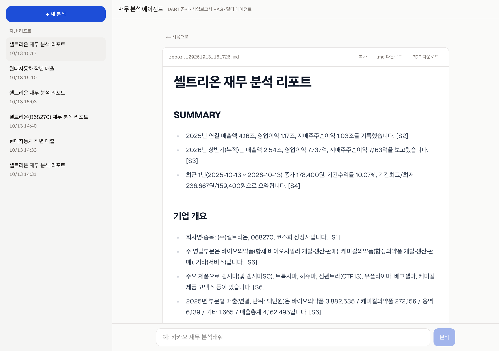
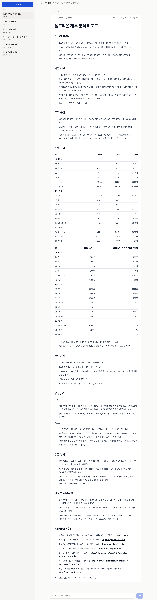
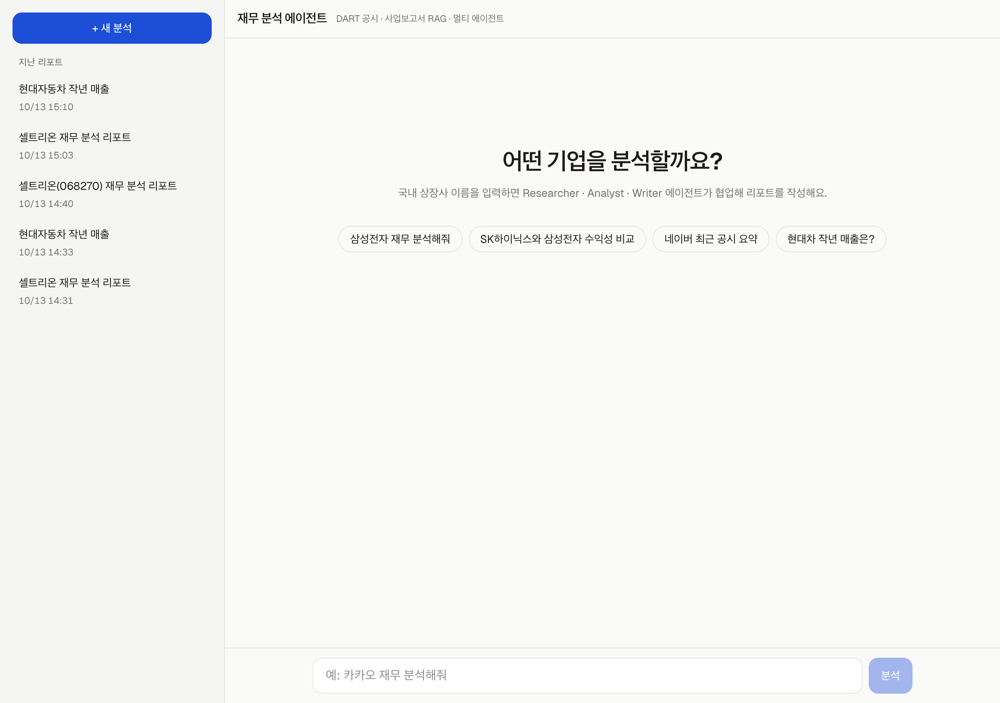

# finance_agent

국내 상장사 재무 분석 멀티 에이전트입니다.
회사 이름을 입력하면 **Supervisor · Researcher · Analyst · Writer** 에이전트가 협업해 DART 공시와 사업보고서를 바탕으로 재무 분석 리포트를 작성합니다.

## 예시: 셀트리온

> 질문: `셀트리온 재무 분석해줘`



<details>
<summary>리포트 전체 화면 보기</summary>



</details>

<details>
<summary>시작 화면</summary>



</details>

---

## 에이전트 설계

### 전체 구조

LangGraph의 **Supervisor 패턴**으로 구성했습니다. Supervisor가 대화 기록을 보고 다음에 일할 에이전트를 한 명씩 고르고, 각 에이전트는 작업을 끝내면 다시 Supervisor에게 돌아옵니다.

```
                 ┌──────────── supervisor ────────────┐
                 │        │           │               │
             researcher  analyst    writer           END
                 └────────┴───────────┴──▶ supervisor
```

| 에이전트 | 역할 | 사용 도구 |
|---|---|---|
| **Supervisor** | 다음 작업자 선택 및 지시 작성 (structured output으로 라우팅) | - |
| **Researcher** | 기업 개황, 재무제표, 주가, 최근 공시, 사업보고서 본문 수집 | `search_company`, `get_company_overview`, `get_financial_statements`, `get_price_summary`, `get_recent_disclosures`, `search_business_report` |
| **Analyst** | 성장성·수익성·안정성·현금흐름·밸류에이션 지표 계산 및 해석 | `calculate_financial_ratios`, `search_business_report`, `calculator` |
| **Writer** | 수집·분석 결과만으로 한국어 Markdown 리포트 작성 | - |

### 라우팅 규칙

- 일반 분석·비교 요청: `researcher → analyst → writer → FINISH`
- 단순 사실 질문 (예: "현대차 작년 매출은?"): `researcher → writer → FINISH`
- 해외 기업이나 재무와 무관한 요청: writer가 지원 범위를 안내
- Supervisor는 `Route(next, instruction)` Pydantic 스키마로 결정을 내려서 잘못된 노드로 가는 일이 없습니다.

### 설계 포인트

1. **에이전트마다 ReAct 서브그래프**
   Researcher와 Analyst는 각각 `LLM ↔ ToolNode` 루프를 도는 서브그래프입니다. 메인 대화에는 서브그래프의 최종 답변만 남겨서, 도구 호출 기록 때문에 컨텍스트가 커지지 않게 했습니다.

2. **숫자는 LLM이 아니라 Python이 계산**
   재무 비율(ROE, PER, FCF 등)은 `calculate_financial_ratios`가 DART 원천 데이터로 직접 계산합니다. 추가 계산도 AST 기반 안전한 `calculator` 도구를 거치게 해서 LLM의 암산 오류를 막았습니다.
   PER은 분기 보고서가 있으면 **TTM(최근 12개월) 지배주주 순이익** 기준으로 계산합니다.

3. **환각 방지 프롬프트**
   모든 에이전트에 "도구 결과에 있는 수치만 사용하고, 없는 값은 만들지 않는다"는 규칙을 넣었습니다. Writer는 대화에 있는 수치만 인용하고 출처(DART / Yahoo Finance)를 표기합니다.

4. **사업보고서 RAG (하이브리드 검색)**
   - DART에서 최신 사업보고서 원문(XML)을 내려받아 목차 기준으로 **서술형 섹션만** 잘라냅니다 (사업의 내용, 경영진단 및 분석의견, 투자자 보호 사항, 영업부문·우발채무 주석). 재무제표 숫자는 API로 정확하게 조회하므로 제외했습니다.
   - 표는 행 단위 텍스트로 바꿔 구조를 유지하고, 1,000자 chunk(150자 overlap)로 나눠 OpenAI 임베딩 후 Chroma에 저장합니다. 보고서(접수번호)별로 한 번만 인덱싱합니다.
   - 검색은 벡터 유사도로 후보 30개를 뽑은 뒤 **한국어 bigram 키워드 점수**를 더해 다시 정렬합니다. 조사나 띄어쓰기가 달라도 키워드가 잘 맞습니다.

5. **안정성**
   - 도구 호출이 8번을 넘으면 도구 없이 최종 답변을 강제해서 무한 루프를 막습니다.
   - DART 오류는 예외 대신 LLM이 읽을 수 있는 문자열로 돌려줘서, 에이전트가 스스로 다른 방법을 시도합니다.
   - 약칭(현대차, 삼전, 엔솔 등)을 정식 회사명으로 바꾸고, 회사명이 애매하면 후보 목록을 돌려줍니다.
   - 연결재무제표가 없으면 별도재무제표로 대체하고, 금융사는 ROE·PBR·배당성향 중심으로 해석합니다.

6. **실시간 진행 상황 스트리밍**
   FastAPI가 `graph.stream(subgraphs=True)` 결과를 SSE 이벤트(`route`, `tool_call`, `tool_result`, `worker_done`, `report`)로 바꿔 보내고, 프론트엔드가 에이전트 파이프라인과 도구 호출 타임라인을 실시간으로 보여줍니다.
   `InMemorySaver` 체크포인터를 써서 같은 `thread_id`로 후속 질문을 이어갈 수 있습니다.

---

## 기술 스택

| 구분 | 기술 |
|---|---|
| **Agent** | LangGraph (Supervisor + ReAct 서브그래프), LangChain Core |
| **LLM** | OpenAI `gpt-5-mini` (`OPENAI_MODEL`로 변경 가능), `text-embedding-3-small` |
| **RAG** | ChromaDB (Persistent), 벡터 + bigram 키워드 하이브리드 검색 |
| **데이터** | OpenDART API (재무제표·기업개황·공시·사업보고서 원문), yfinance (주가·시가총액) |
| **Backend** | Python, FastAPI, Uvicorn, SSE 스트리밍 |
| **Frontend** | Next.js 16, React 19, TypeScript, Tailwind CSS 4, react-markdown (+ remark-gfm) |

---

## 프로젝트 구조

```
.
├── data/                  # 문서 풀 (DART 기업 코드 캐시, 사업보고서 Chroma 인덱스 — 실행 시 생성)
├── agents/                # Agent 모듈
│   ├── graph.py           # Supervisor 멀티 에이전트 그래프
│   ├── tools.py           # 데이터 수집 · 재무 비율 계산 도구
│   ├── dart.py            # OpenDART API 클라이언트
│   └── rag.py             # 사업보고서 파싱 · 인덱싱 · 하이브리드 검색
├── prompts/               # 프롬프트 템플릿
│   ├── supervisor.md
│   ├── researcher.md
│   ├── analyst.md
│   └── writer.md
├── outputs/               # 실행 결과 저장 (report_YYYYMMDD_HHMMSS.md)
├── app.py                 # 실행 스크립트 (CLI + FastAPI SSE API)
├── frontend/              # Next.js 웹 UI
├── docs/images/           # README 스크린샷
├── requirements.txt
└── README.md
```

## 실행 방법

### 1. 환경 변수

루트에 `.env` 파일을 만듭니다.

```env
OPENAI_API_KEY=sk-...
OPENDART_API_KEY=...      # https://opendart.fss.or.kr 에서 발급
OPENAI_MODEL=gpt-5-mini   # 선택
```

### 2. 백엔드

```bash
python -m venv .venv && source .venv/bin/activate
pip install -r requirements.txt
uvicorn app:app --reload --port 8000
```

### 3. 프론트엔드

```bash
cd frontend
cp .env.example .env.local   # NEXT_PUBLIC_API_URL=http://localhost:8000
npm install
npm run dev                  # http://localhost:3000
```

### CLI로 실행

```bash
python app.py                         # 대화형 모드
python app.py "셀트리온 재무 분석해줘"   # 단일 질문
```

## API

| Method | Path | 설명 |
|---|---|---|
| `POST` | `/api/analyze` | 질문을 받아 에이전트 진행 상황을 SSE로 스트리밍 |
| `GET` | `/api/reports` | 저장된 리포트 목록 (`outputs/`) |
| `GET` | `/api/reports/{name}` | 리포트 본문 |
| `GET` | `/api/health` | 헬스 체크 |

---

> 본 프로젝트의 리포트는 정보 제공 목적이며 투자 권유가 아닙니다.
