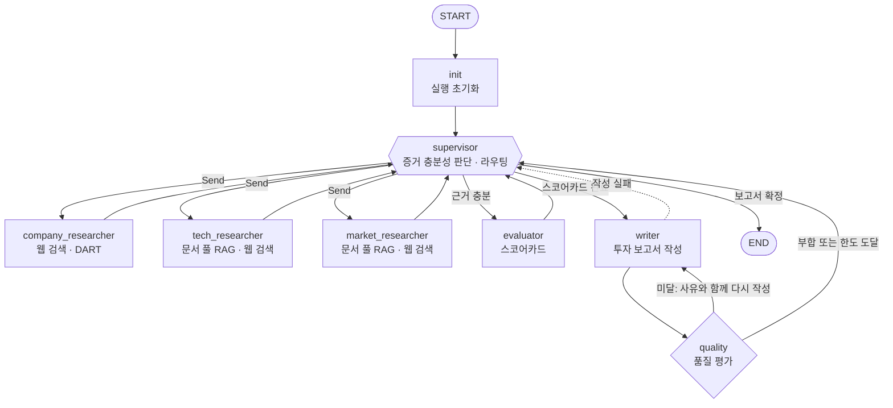

# AI Startup Investment Evaluation Agent

Physical AI / Robotics 스타트업의 투자 가능성을 조사·평가하는 LangGraph Multi-Agent 프로젝트입니다.
기업 정보와 기술 문서에서 근거를 수집하고, 평가 항목별 분석과 출처를 포함한 투자 검토 보고서를 생성합니다.

> 질문 예: `Figure AI 투자 가능성 평가해줘`, `레인보우로보틱스와 두산로보틱스를 투자 관점에서 비교해줘`

## Subject

본 프로젝트는 Physical AI / Robotics 스타트업을 대상으로, 기업 정보와 기술 문서에서 수집한 근거를
기술 성숙도·시장성·이해관계자·도메인 적용 관점에서 평가하는 Supervisor 패턴 기반으로 설계/개발 하는 프로젝트 임.

## Overview

- Objective : 하나의 스타트업을 복수 관점(기술 성숙도, 시장성, 이해관계자, 도메인 적용)과 6개 투자 평가 항목으로 평가해, 출처가 달린 투자 보고서(PDF)를 생성
- Pattern : Supervisor — 조사할 내용과 양이 기업마다 다르다. 비상장·해외 기업은 웹 검색에, 국내 상장사는 공시에 근거가 있고, 어떤 평가 항목의 근거가 비는지는 조사해 봐야 알 수 있다. 그래서 한 에이전트(Supervisor)가 매 턴 지금까지의 근거를 보고 다음 작업을 정하는 구조를 택했다
- 동적 처리 : 정해진 순서가 없다. Supervisor가 매 턴 `Route(sufficient, missing, needs_scorecard, reason, assignments)`로 결정한다
    - 증거 충분성 판단 : 평가 항목마다 출처가 달린 근거가 있는지 판단하고, 충분할 때만 보고서 작성으로 넘어간다
    - 항목별 재조사 루프 : 근거가 빈 평가 항목만 짚어 담당 Researcher에게 다시 맡긴다
    - 동적 fan-out : 서로 독립인 작업은 `Send`로 최대 3개까지 동시에 실행한다 (세 Researcher 동시 실행, 비교 기업별 조사)
    - 질문에 따라 경로가 달라진다 : 단순 사실 질문은 Researcher 한 명과 Writer만 거치고, 투자 평가 요청은 Evaluator와 품질 평가 루프까지 거친다
    - 품질 평가 루프 : 보고서가 품질 기준에 미달하면 사유와 함께 Writer로 되돌린다

## Selected Targets

- 도메인 : Physical AI / Robotics — AI가 로봇 하드웨어와 결합하는 초기 시장이라 기업 간 기술 성숙도와 사업화 단계의 편차가 크고, 공개 정보가 흩어져 있어 다관점 근거 수집의 효과가 크다
- 해외 비상장 스타트업 (예: Figure AI) — 공시가 없어 웹 검색과 문서 풀이 주된 근거다. 근거가 부족한 항목을 "평가 보류"로 처리하는 흐름을 검증하는 대상
- 국내 상장 로봇 기업 (예: 레인보우로보틱스) — DART 재무제표·공시를 근거로 쓸 수 있다. 재무 근거가 있는 경우의 흐름을 검증하는 대상

## Features

- PDF 자료 기반 정보 추출 : `data/docs`의 Physical AI · 로보틱스 보고서(증권사 산업 분석, 싱크탱크 정책 보고서, 컨설팅사 전망) 4건을 쪽 단위로 파싱해 인덱싱하고, 벡터 유사도 + 한국어 bigram 키워드 점수로 하이브리드 검색한다. 결과마다 문서 제목·발행기관·날짜·쪽수가 붙는다
- 웹 검색 기반 기업 정보 수집 : Tavily로 설립·팀·제품·고객·투자 유치 이력·최근 뉴스를 찾는다
- 국내 상장사 공시 조회 : OpenDART에서 기업 개황·재무제표·최근 공시를 조회한다 (비상장·해외 기업은 웹 검색 근거만 사용)
- 투자 평가 스코어카드 : 6개 항목(팀·창업자 20%, 기술력·차별성 25%, 시장성 20%, 사업화·트랙션 15%, 경쟁 우위 10%, 재무·투자 유치 10%)을 1~5점으로 평가한다. 가중 합산과 투자 의견(75점 이상 긍정 검토 / 60점 이상 조건부 검토 / 그 미만 보류)은 LLM이 아니라 Python이 계산하고, 근거가 없는 항목은 추정하지 않고 "평가 보류"로 둔다
- 정해진 형식의 투자 보고서 : SUMMARY로 시작해 REFERENCE로 끝난다. 본문은 사업 아이디어 / 팀 구성 / 기술 분석 / 시장 규모 및 경쟁 구도 / 사업화 및 재무 / 투자 평가 / 사업 리스크(시장·기술·규제·경쟁) / 한계점으로 구성하고, REFERENCE는 자료 종류별 표기 형식(기관 보고서 · 학술 논문 · 웹페이지)을 따른다. 형식은 코드로 검사해 어긋나면 고쳐 쓴다
- 보고서 구성 최대 10장 : 장은 SUMMARY와 REFERENCE를 포함해 10개로 고정이고, PDF 분량도 A4 10쪽을 넘지 않는다. 둘 다 형식 검사에서 확인해 넘으면 줄여 쓰게 한다
- PDF 출력 : 최종 보고서를 A4 PDF로 저장한다 (원본 Markdown도 함께 저장)
- 확증 편향 방지 전략
    - 수집 단계 : Researcher에게 서로 다른 출처에서 근거를 모으고, 유리한 근거뿐 아니라 불리한 근거와 비판적 시각도 찾게 한다. 회사의 주장과 제3자가 확인한 사실을 구분해 보고한다
    - 평가 단계 : 회사의 주장만 있고 제3자 확인이 없는 항목은 보수적으로 평가하고, 근거가 없으면 점수를 매기지 않는다
    - 작성 단계 : 리스크와 한계점 장을 필수로 두고, 기술의 우열을 판정하거나 추천하는 표현을 쓰지 않는다
    - 검증 단계 : 품질 평가의 "편향 통제" 항목이 출처 5개 이상, 한 출처가 본문 인용의 40% 이하, 리스크 장에 출처가 달린 근거 2건 이상인지 확인한다
- 보고서 품질 평가 : 보고서 생성 후 품질 평가 노드가 4개 항목을 "부합 여부"로만 판정한다. 내용의 옳고 그름이 아니라 형식으로 확인되는 것만 코드로 검사하며(LLM 미사용), 미달이면 사유를 붙여 Writer에게 되돌린다 (최대 2회)

    | 평가 항목     | 부합 조건                                                                                                                                                                                                               |
    | ------------- | ----------------------------------------------------------------------------------------------------------------------------------------------------------------------------------------------------------------------- |
    | Groundedness  | 본문 인용 `(기관명, 연도)`가 모두 REFERENCE에 대응 · REFERENCE 항목이 모두 본문에 인용됨 · REFERENCE의 URL이 모두 도구가 실제로 돌려준 것 · 내부 에이전트·도구 이름을 출처로 쓰지 않음 · 사실 서술 줄의 70% 이상에 인용 |
    | 중립성        | "최고", "가장 우수", "독보적", "압도적", "우월", "추천" 등 기술의 우열 판정·추천 표현이 본문에 없음                                                                                                                     |
    | 편향 통제     | 서로 다른 출처 5개 이상 · 한 출처가 본문 인용의 40% 이하 · 리스크 장에 출처가 달린 근거 2건 이상 · 한계점 장이 비어 있지 않음                                                                                           |
    | 관점 커버리지 | `기술 성숙도`, `시장성`, `이해관계자`, `도메인 적용` 절이 모두 있고 각각 80자 이상                                                                                                                                      |

- 실행 트레이스 : 모든 결정과 사유, 작업 결과, 품질 평가 결과를 `outputs/traces/<run_id>.jsonl`에 남긴다

## Tech Stack

- Framework : LangGraph (Supervisor + ReAct 서브그래프, `Send` fan-out), LangChain Core
- LLM/Generator : OpenAI `gpt-5-mini` (`OPENAI_MODEL`로 변경 가능)
- LLM/Judge : 사용하지 않음 — 보고서 품질 평가는 규칙 기반 코드(`agents/quality.py`)로 판정한다
- Retrieval : FAISS (IndexFlatL2, 218 chunks) + bigram 키워드 재정렬 - Hit Rate@5 0.85, MRR@10 0.82
    - 측정 방법 : 문서 풀에서 무작위로 뽑은 chunk 40개마다 `gpt-5-mini`로 질문을 하나씩 만들고, 그 질문으로 검색했을 때 원래 chunk가 몇 번째에 나오는지 측정했다. 벡터 검색만 쓰면 Hit Rate@5 0.83, MRR@10 0.79다
    - 합성 질문 40개로 잰 값이므로 참고용이다
- Embedding : `BAAI/bge-m3` (로컬 실행, 정규화 임베딩)
- 그 밖 : Tavily (웹 검색), OpenDART API · yfinance (국내 상장사 공시 · 시가총액), PyMuPDF (PDF 파싱 · PDF 출력)

## Agents

- Supervisor : 매 턴 증거가 충분한지 판단하고 다음 작업과 지시를 정한다. 독립인 작업은 동시에 내보내고, 결정마다 사유를 남긴다
- Company Researcher : 기업 정보 수집. 웹 검색으로 설립·팀·제품·고객·투자 유치·도입 사례·이해관계자를 찾고, 국내 상장사는 DART에서 기업 개황·재무제표·공시를 조회한다
- Tech Researcher : 기술 근거 수집. 문서 풀과 웹에서 핵심 기술, 기술 성숙도(시연·실증·양산 단계), 특허·논문을 찾는다
- Market Researcher : 시장·경쟁 근거 수집. 문서 풀과 웹에서 시장 규모·성장 전망·정책, 경쟁사 현황을 찾는다
- Evaluator : 수집된 근거로 평가 항목별 점수와 근거를 정하고 스코어카드(종합 점수·투자 의견)를 산출한다
- Writer : 조사·평가 결과만으로 정해진 형식의 투자 보고서를 작성한다
- Quality : 보고서 품질을 4개 항목의 부합 여부로 판정하고, 미달이면 Writer로 되돌린다 (LLM을 쓰지 않는 검사 노드)

## State Schema

스키마는 `agents/state.py`에 있다.

| 구분      | 필드                        | 내용                                                                      |
| --------- | --------------------------- | ------------------------------------------------------------------------- |
| 페이로드  | `messages`                  | 사용자 질문과 최종 보고서 (후속 질문의 맥락). 최근 7개만 유지             |
| 페이로드  | `findings`                  | 이번 질문에서 worker가 낸 결과와 도구가 돌려준 URL. 질문이 시작될 때 비움 |
| 페이로드  | `report`                    | 이번 질문의 투자 보고서                                                   |
| 제어 메타 | `run_id`, `status`          | 질문 한 건의 실행 ID, 실행 상태(`running` / `done` / `failed`)            |
| 제어 메타 | `step`, `rounds`            | Supervisor 결정 횟수, 조사 작업 수                                        |
| 제어 메타 | `decision`                  | 마지막 결정 (충분성, 부족한 항목, 사유, 내보낸 작업)                      |
| 제어 메타 | `errors`                    | 이번 질문에서 실패한 작업                                                 |
| 제어 메타 | `quality`, `quality_rounds` | 마지막 품질 평가 결과, 품질 미달로 다시 쓰게 한 횟수                      |

- 제어 vs 페이로드 분리 : 위 표처럼 필드를 나눴다. Supervisor의 조정 로직(종료·상한·재시도)은 제어 메타만 읽고, 페이로드는 LLM에 보여 줄 때만 쓴다. worker는 전체 State가 아니라 `WorkerInput`(대화 + 지시)만 받는다
- 관측성 위치 : State에는 마지막 결정 하나만 두고, 결정 이력·사유·작업 결과 본문·품질 평가 결과는 외부 트레이스 `outputs/traces/<run_id>.jsonl`에 남긴다
- 지속성 비용 : `findings`·`errors`는 질문마다 초기화하고 `messages`는 길이를 제한한다. worker 내부의 도구 호출 기록(검색 결과 본문 등)은 체크포인트에 저장하지 않는다
- 상관 : 트레이스의 모든 줄에 `run_id`와 `step`이 있고, 시작 이벤트에 `thread_id`, 종료 후 보고서 파일 경로가 기록된다
- 재개/복구 : `status`, `step`, `rounds`, `decision.tasks`(하던 작업), `errors`(시도 횟수)가 State에 있다. worker 오류는 State에 기록해 1회 재시도하고, 실행이 중단되면 마지막 체크포인트에서 이어서 실행한다 (대화형 모드의 `resume`)
- 동시 처리 : 병렬 worker가 쓰는 `findings`, `errors`, `messages`에는 reducer가 있다. 나머지 필드는 한 번에 한 노드(init, supervisor, 단독 실행되는 writer와 quality)만 쓴다
- 종료 보장 : 결정 10회(`MAX_STEPS`), 조사 작업 5건(`MAX_RESEARCH_ROUNDS`), 작업당 시도 2회(`MAX_ATTEMPTS`), 품질 미달 다시 쓰기 2회(`MAX_QUALITY_ROUNDS`), worker 내부 도구 호출 8회로 모든 반복에 상한을 둔다. 조사 한도에 닿으면 지금까지의 근거로 평가하고 보고서를 쓰며, 근거를 못 구한 항목은 "확인되지 않음"으로 밝힌다

## Architecture



- 세 Researcher는 서로 독립이라 한 번에 동시에 실행되고, 근거가 부족한 평가 항목이 있으면 Supervisor가 해당 Researcher만 다시 부른다
- 단순 사실 질문은 Researcher 한 명 → Writer → Quality 경로로 끝난다

## Directory Structure

```
├── data/                  # 문서 풀
│   ├── docs/              # 원본 PDF와 metadata.json (서지 정보)
│   └── vectorstores/      # FAISS 인덱스 (BAAI--bge-m3)
├── agents/                # Agent 모듈
│   ├── graph.py           # Supervisor 멀티 에이전트 그래프
│   ├── state.py           # State 스키마
│   ├── criteria.py        # 투자 평가 항목 · 스코어카드 계산
│   ├── tools.py           # 웹 검색 · 문서 풀 · DART · 스코어카드 도구
│   ├── docs.py            # 문서 풀 인덱싱 · 하이브리드 검색
│   ├── dart.py            # OpenDART API 클라이언트
│   ├── report.py          # 보고서 형식 검사 (목차 · REFERENCE 표기)
│   ├── quality.py         # 보고서 품질 평가
│   ├── pdf.py             # 보고서 PDF 변환
│   └── trace.py           # 실행 트레이스 (JSONL)
├── prompts/               # 프롬프트 템플릿 (supervisor, company/tech/market_researcher, evaluator, writer)
├── outputs/               # 실행 결과 저장 (report_*.pdf · .md, traces/<run_id>.jsonl)
├── app.py                 # 실행 스크립트
├── requirements.txt
└── README.md
```

## Usage

`.env`에 API 키를 넣는다.

```env
OPENAI_API_KEY=sk-...
TAVILY_API_KEY=tvly-...   # 웹 검색
OPENDART_API_KEY=...      # 국내 상장사 공시
OPENAI_MODEL=gpt-5-mini   # 선택
```

```bash
pip install -r requirements.txt

# data/docs 에 PDF와 metadata.json 을 넣고 문서 풀 인덱스를 만든다 (문서를 바꿀 때마다 다시 실행)
python -m agents.docs

python app.py                                  # 대화형 모드
python app.py "Figure AI 투자 가능성 평가해줘"   # 단일 질문
```

- 보고서는 `outputs/report_YYYYMMDD_HHMMSS.pdf`로 저장된다
- 임베딩 모델(`BAAI/bge-m3`, 약 2.3GB)은 처음 실행할 때 내려받는다
- 투자 평가 요청 한 건은 3~5분 걸린다

## Contributors

- 김근홍 : Agent Design, Supervisor Routing, State Schema
- 한유진 : Prompt Engineering, 투자 평가 항목 · 스코어카드 설계
- 허지원 : PDF Parsing, Embedding, Retrieval (문서 풀 RAG)
- 심혁 : Web Search · DART 도구, Research Agent
- 정순욱 : 보고서 형식, 품질 평가, PDF 출력, 문서화
