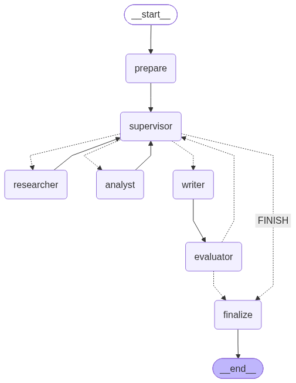

# Subject
국내 상장사를 **기업 개요·재무제표·주가·공시·사업 구조·재무 비율** 여섯 관점에서 근거를 모아 재무 분석 리포트를 만드는 프로젝트입니다. **Supervisor 패턴** 기반 멀티 에이전트로 설계·개발했습니다.
사용자가 회사 이름을 입력하면 Supervisor가 관점별 근거가 충분한지 평가하면서 하위 에이전트에게 작업을 배분합니다. 리포트가 나오면 품질 평가(Groundedness · 중립성 · 편향 통제)를 통과할 때까지 수정 Loop를 돕니다.

## Overview
- **Objective**: 한 기업을 여러 관점(재무·시장·정성)에서 근거 기반으로 평가하되, 투자 권유나 우열 판정은 하지 않음
- **Pattern**: **Supervisor**
  - 재무 분석은 "무엇이 더 필요한지"가 수집 결과를 봐야 정해집니다. 예를 들어 사업보고서 검색이 실패하거나, 비율 계산에 시가총액이 빠지거나, 품질 평가에서 근거 없는 인과 설명이 지적되는 경우입니다.
  - 그래서 계획을 미리 고정하는 Orchestrator-Workers보다, 매 턴 State를 보고 **재조사·재작업 루프**를 돌 수 있는 Supervisor가 목적에 맞다고 판단했습니다.
  - 재무 데이터 수집은 앞 단계 결과(정식 회사명, 최신 보고서 종류)에 의존하는 순차 작업이 많습니다. 따라서 병렬 Fan-out으로 얻는 이득이 작습니다.
- **동적 처리**: 실행 순서가 고정되어 있지 않습니다.
  - Supervisor는 `State`의 **확보 관점(coverage)·근거 충분도(sufficiency)·재작업 횟수·품질 평가 결과**를 보고 `add_conditional_edges`로 분기합니다.
  - 질문 유형에 따라 경로가 달라집니다. 분석 요청은 `researcher → analyst → writer`, 단순 질문은 `researcher → writer`, 범위 밖 요청은 `writer`(안내)로 바로 갑니다.
  - 필수 관점이 비어 있으면 writer로 가지 않고 담당 에이전트에게 **재작업**을 지시합니다.
  - 품질 평가에서 미달이면 Supervisor로 돌아갑니다. 서술 문제는 writer가 **재작성**하고, 근거 부족은 researcher/analyst가 **재수집**합니다.
  - 같은 질문도 수집 결과에 따라 경로가 달라집니다([Example](#example-셀트리온)). 셀트리온 분석은 한 번은 Supervisor 5회 결정에 researcher 재작업 2회로 끝났고, 다른 실행에서는 평가 미달로 writer 재작성 Loop가 2회 돌았습니다. 단순 질문(현대차 작년 매출)은 Supervisor 2회 결정으로 끝났습니다.

## Selected Targets & Data
이 프로젝트의 평가 대상은 "기술"이 아니라 **국내 상장사**입니다. 관점별 근거를 서로 다른 출처에서 확보하도록 데이터 소스를 골랐습니다.
- **재무·공시 (DART / OpenDART API)**: 금융감독원 공식 공시라서 수치의 원천성이 가장 높습니다. 연결 재무제표, 기업 개황, 최근 공시, 사업보고서 원문을 사용합니다.
- **시장 데이터 (Yahoo Finance / yfinance)**: 주가·시가총액은 DART에 없습니다. 밸류에이션(PER·PBR)과 주가 동향을 위해 별도 제공처를 사용합니다.
- **정성 근거 (사업보고서 RAG)**: 실적 변동 원인·사업 구조·리스크는 숫자 API로는 알 수 없어, 사업보고서 서술형 섹션을 RAG로 검색합니다.

## Features
- **DART 사업보고서 기반 정보 추출**: 원문 XML을 목차 기준으로 잘라 **서술형 섹션만** 인덱싱합니다(사업의 내용, 경영진단 및 분석의견, 투자자 보호, 영업부문·우발채무 주석). 검색은 벡터 + 한국어 bigram 키워드 하이브리드로 합니다.
- **숫자는 Python이 계산**: ROE·PER·FCF 등은 `calculate_financial_ratios`가 DART 원천 데이터로 계산합니다(PER은 TTM 지배주주 순이익 기준). 추가 계산은 AST 기반 `calculator`만 허용합니다.
- **근거 출처 추적**: 하위 에이전트의 도구 호출 결과에서 출처(`Source`: 제공처·관점·URL)를 자동으로 추출해 `S1, S2…` id를 붙입니다. 리포트 본문은 `[S#]`로 인용하고 `REFERENCE`에 나열합니다.
- **근거 충분도 평가 후 작성**: 필수 관점(분석 요청은 6개)이 대상 기업 수만큼 확보됐는지 **규칙으로 판정**합니다. LLM 판단과 함께 써서, 근거가 부족하면 writer로 가지 못하게 합니다.
- **확증 편향 방지 전략**
  - 출처 제공처 2종 이상(DART·Yahoo Finance), 서로 다른 출처 3개 이상 인용을 규칙으로 강제합니다.
  - `강점 / 리스크` 섹션을 필수로 두고, 프롬프트에서 비슷한 비중으로 다루도록 지시합니다.
  - 비교 분석은 "어느 기업이 우위"가 아니라 지표 수치 차이를 나란히 제시합니다.
  - 전망은 회사가 사업보고서에 밝힌 내용만, 주체를 드러내 인용합니다.
- **보고서 품질 평가 (Hybrid = 규칙 + LLM Judge)**

  | 평가 항목 | 규칙 검사 (결정적) | LLM Judge (내용) |
  |---|---|---|
  | Groundedness | `SUMMARY`·`REFERENCE` 목차, `[S#]` 인용이 출처 목록에 존재, 리포트의 금액·비율 수치 90% 이상이 근거 자료에 그대로 존재 | 주장·인과 설명이 근거 자료로 뒷받침되는가 |
  | 중립성 | 매수/매도 의견·목표주가·비중확대·"저평가 매력" 등 투자 권유 표현 정규식 차단 | 근거 없는 우열 판정·단정적 전망이 없는가 |
  | 편향 통제 | 제공처 2종↑, 출처 3개↑ 인용, 리스크 섹션 존재 | 강점·리스크 균형, 단일 출처 의존 여부 |

  - 규칙과 Judge를 **모두 통과해야 pass**입니다. 미달이면 피드백(`rule_issues`, `fix_target`)을 State에 남기고 Supervisor로 Loop합니다. 수정 한도(2회)에 도달하면 경고를 붙여 종료합니다.
- **실시간 진행 상황**: FastAPI SSE(`route`, `tool_call`, `worker_done`, `evaluation`, `report`)와 Next.js UI로 라우팅 사유, 규칙 가드 개입, 평가 점수를 실시간으로 표시합니다.

## Tech Stack
| 구분 | 기술 |
|---|---|
| Framework | LangGraph (`StateGraph` + `add_conditional_edges`, ReAct 서브그래프), LangChain Core |
| LLM / Generator | OpenAI `gpt-5-mini` (`OPENAI_MODEL`로 변경) |
| LLM / Judge | OpenAI `gpt-5-mini` (`JUDGE_MODEL`로 분리 가능) + 규칙 검사 |
| Retrieval | ChromaDB (Persistent, cosine), 벡터 후보 30개 → bigram 키워드 점수로 재정렬 |
| Embedding | OpenAI `text-embedding-3-small` |
| Data | OpenDART API, yfinance |
| Observability | LangSmith Tracing, JSONL 결정 로그 (`outputs/logs/decisions.jsonl`) |
| Serving | FastAPI + SSE, Next.js 16 / React 19 / Tailwind CSS 4 |

## Agents
- **Supervisor** ([supervisor.py](finance_agent/supervisor.py)): 조정 계층
  1. 첫 턴에 요청을 `TaskSpec`(analysis / fact / out_of_scope, 대상 기업, 필수 관점)으로 분석합니다.
  2. 매 턴 규칙으로 근거 충분도(`Sufficiency`)를 계산합니다. 이어서 LLM이 `Route`(근거 충분 여부, 다음 작업자, 지시, 사유)를 제안합니다.
  3. **규칙 가드**가 제안을 검증합니다. 누락 관점이 있으면 재작업, 재작업 상한에 도달하면 다음 단계로 진행(fallback), 평가 후 재수집을 1회 했으면 재작성, 결정 상한에 도달하면 강제 마무리합니다.
- **Researcher**: 기업 개황·재무제표(연간/최신 분기)·주가·최근 공시·사업보고서 RAG를 수집합니다.
  - 도구: `search_company`, `get_company_overview`, `get_financial_statements`, `get_price_summary`, `get_recent_disclosures`, `search_business_report`
- **Analyst**: 성장성·수익성·안정성·현금흐름·밸류에이션 지표를 계산하고 해석합니다. 금융사는 ROE·PBR 중심으로 봅니다.
  - 도구: `calculate_financial_ratios`, `search_business_report`, `calculator`
- **Writer**: 확보한 근거와 출처 목록만으로 `[S#]` 인용 리포트를 작성합니다. 재작성 시에는 이전 초안과 평가 피드백을 반영합니다.
- **Evaluator** ([evaluator.py](finance_agent/evaluator.py)): 규칙 검사 + LLM Judge로 품질을 평가합니다. 미달 시 Supervisor로 Loop합니다.

> 하위 에이전트끼리는 엣지가 없습니다. 모든 작업자는 결과를 State에 쓰고 Supervisor로만 돌아갑니다(researcher/analyst → supervisor, writer → evaluator → supervisor).

## State Schema
[state.py](finance_agent/state.py)

```python
class FinanceState(TypedDict):
    # ── 작업 페이로드 ──
    messages: Annotated[list, add_messages]          # 사용자 질문 + 최종 리포트 (후속 질문용)
    question: str
    task: TaskSpec | None                            # 요청 유형·대상 기업·필수 관점
    findings: Annotated[dict[str, Finding], merge_findings]   # 에이전트별 최신 결과
    sources: Annotated[list[Source], merge_sources]  # 출처 메타데이터 (원문 X)
    report: str
    eval_result: EvalResult | None                   # 규칙 결과 + Judge verdict + fix_target
    # ── 제어 메타데이터 ──
    trace_id: str                                    # 외부 로그·LangSmith 상관 키
    next: str; instruction: str                      # add_conditional_edges 분기 키 / 지시
    decision: Decision | None                        # 최신 결정 1건 (next, reason, override)
    sufficiency: Sufficiency | None                  # covered / missing / sufficient
    step_count: int; revision_count: int
    rework_count: Annotated[dict[str, int], merge_dict]
    node_status: Annotated[dict[str, str], merge_dict]        # running / done / failed
    last_error: str | None
```

- **제어 vs 페이로드 분리**
  - 두 블록을 필드 단위로 나눴습니다. 라우팅에 필요한 최소 상태는 `task.required_perspectives`, `sufficiency`, `rework_count`, `revision_count`, `eval_result.passed/fix_target`, `step_count`입니다.
  - Supervisor의 규칙 가드는 페이로드 본문을 읽지 않고 이 값들만으로 판단합니다. LLM에는 findings를 1,500자로 잘라 요약해서 넘깁니다.
- **관측성 위치**
  - State에는 **최신 결정 1건**(`decision`: next, reason, 규칙 가드 override 사유)만 둡니다.
  - 결정 이력 전체(라우팅 제안 vs 최종 결정, 근거 충분도, 평가 점수, 실패)는 `log_decision()`이 외부 JSONL로 적재합니다. 각 노드의 LLM 호출은 LangSmith에 `run_name`으로 남습니다.
- **지속성 비용**
  - 도구 원문은 서브그래프 안에서만 쓰고 메인 State에는 남기지 않습니다. 재무제표 원본 표만 숫자 보존을 위해 Finding에 첨부합니다.
  - `findings`는 에이전트별 **최신 1건**으로 덮어씁니다. 재작업분은 기존 결과에 덧붙이며, 재작업 상한 덕분에 크기가 제한됩니다.
  - `sources`는 key 기준으로 중복을 제거한 메타데이터만 둡니다. `messages`에는 사용자 질문과 최종 리포트만 쌓이고, 리포트 초안은 `report` 한 필드에 덮어씁니다.
- **상관**
  - 실행마다 `trace_id`를 발급해 State와 LangSmith(`metadata.trace_id`, `tag trace:<id>`), JSONL 로그, 리포트 저장 로그(`output.saved`)에 똑같이 기록합니다.
  - `thread_id`는 대화(체크포인트) 단위, `trace_id`는 실행 단위입니다.
- **재개/복구**
  - `node_status`, `last_error`, 카운터와 `InMemorySaver` 체크포인터(thread_id)로 마지막 슈퍼스텝부터 재개할 수 있습니다.
  - 하위 에이전트 예외는 그래프를 멈추지 않습니다. `failed` 상태와 오류를 State에 남기면 Supervisor가 **재시도(재작업 한도 내) 또는 제외(누락 관점은 "데이터 없음"으로 명시)**를 결정합니다. 도구 예외는 `ToolNode(handle_tool_errors=True)`가 LLM이 읽을 수 있는 메시지로 바꿉니다.
  - 새 질문이 들어오면 `prepare` 노드가 실행 단위 필드를 초기화합니다(reducer에 `None`을 넘기면 리셋).
- **동시 처리**
  - 누적 필드는 모두 reducer로 병합합니다. `findings`는 에이전트 키 단위 병합, `sources`는 key 중복 제거 append, `rework_count`·`node_status`는 키 단위 병합, `messages`는 `add_messages`입니다.
  - Supervisor 패턴은 한 슈퍼스텝에 작업자 하나만 실행하므로 쓰기 충돌은 없습니다. 그래도 노드는 전체 덮어쓰기 대신 부분 업데이트만 반환하게 해서, 병렬 노드를 추가해도 안전한 구조로 만들었습니다.
- **종료 보장**
  - 무한 루프를 막는 상한을 단계별로 두었습니다: `MAX_STEPS=12`(Supervisor 결정), `MAX_REWORK=2`(에이전트별 재작업), `MAX_REVISIONS=2`(평가 미달 재작성).
  - 서브그래프에도 `MAX_TOOL_ROUNDS=8`(도구 라운드), `MAX_CALLS_PER_ROUND=8`(라운드당 병렬 호출)을 두고, LangGraph `recursion_limit=80`을 추가로 겁니다.
  - 상한에 도달하면 규칙 가드가 writer 또는 finalize로 강제 분기합니다.

## Architecture


```
prepare → supervisor ──(add_conditional_edges: State["next"])──┬─▶ researcher ─┐
              ▲                                                ├─▶ analyst ────┤→ supervisor
              │                                                ├─▶ writer → evaluator ─┬─ 미달 & 수정 여력 → supervisor
              │                                                └─▶ FINISH ─────────────┴─ 통과 / 한도 → finalize → END
```

## LangSmith Tracing
- `.env`에 `LANGSMITH_TRACING=true`, `LANGSMITH_API_KEY`, `LANGSMITH_PROJECT`를 설정하면 실행이 `finance-supervisor` run으로 기록됩니다. 각 실행의 `trace_id`는 CLI 첫 줄에 출력되고, 같은 값이 JSONL 로그에도 남습니다.
- 트레이스 캡처: `docs/images/tracing-1.png`, `tracing-2.png`, … (경로가 길면 순서대로 나눠 제출합니다)

## Example: 셀트리온
> 질문: `셀트리온 재무 분석해줘`

| step | Supervisor 결정 | 사유 (결정 로그 요약) |
|---|---|---|
| 1 | → researcher | 근거 없음, 6개 관점 전부 누락 |
| 2 | → researcher (재작업 1) | 사업보고서 검색 오류로 '사업 구조·리스크' 관점 누락 |
| 3 | → analyst | '재무 비율' 관점만 누락 |
| 4 | → researcher (재작업 2) | 규칙상 관점은 모두 확보, LLM이 analyst 해석을 검증할 사업보고서 근거가 부족하다고 판단 |
| 5 | → writer | researcher 재작업 한도 도달 → 확보 근거로 작성, 제약 명시 |
| – | evaluator 통과 | 규칙 8/8, Judge groundedness·neutrality·bias 5/5/5 → finalize |

- 같은 질문의 다른 실행에서는 evaluator가 중립성(투자 권유 표현)과 groundedness(근거 없는 인과 설명) 미달을 연달아 판정했습니다. 그때마다 Supervisor로 돌아가 writer 재작성 → 재평가 Loop를 돌았고, 2회 수정 후 통과했습니다.
- 각 실행의 결정 이력은 `outputs/logs/decisions.jsonl`에서 `trace_id`로 조회할 수 있습니다.


## Directory Structure
```
.
├── finance_agent/
│   ├── graph.py          # StateGraph 조립 (노드·조건부 엣지)
│   ├── state.py          # State Schema, 구조화 산출물, reducer, 종료 상한
│   ├── supervisor.py     # 조정 계층: 요청 분석·근거 충분도·라우팅·규칙 가드
│   ├── agents.py         # 하위 에이전트: researcher·analyst(ReAct)·writer, 출처 추출
│   ├── evaluator.py      # 품질 평가 노드 (규칙 + LLM Judge), finalize
│   ├── observability.py  # 결정 로그(JSONL), LangSmith run config
│   ├── prompts.py        # 프롬프트 템플릿
│   ├── tools.py          # 데이터 수집·재무 비율 계산 도구
│   ├── dart.py           # OpenDART API 클라이언트
│   └── rag.py            # 사업보고서 파싱·인덱싱·하이브리드 검색
├── backend/app.py        # FastAPI (SSE 분석 API, 리포트 API)
├── frontend/             # Next.js 웹 UI
├── docs/images/          # 그래프·실행 화면·트레이스 캡처
├── outputs/              # 실행 결과 (reports/, logs/decisions.jsonl) — git 제외
├── main.py               # CLI 실행
└── requirements.txt
```

## Usage
```bash
# 1. 환경 변수
cp .env.example .env      # OPENAI_API_KEY, OPENDART_API_KEY, (LANGSMITH_*) 입력

# 2. 설치 및 CLI 실행
python -m venv .venv && source .venv/bin/activate
pip install -r requirements.txt
python main.py "셀트리온 재무 분석해줘"   # 단일 질문 (리포트: outputs/reports/)
python main.py                           # 대화형 모드
python main.py --graph                   # 그래프 이미지 생성 (docs/images/graph.png)

# 3. (선택) 웹 UI
uvicorn backend.app:app --reload --port 8000
cd frontend && cp .env.example .env.local && npm install && npm run dev   # http://localhost:3000
```

| Method | Path | 설명 |
|---|---|---|
| `POST` | `/api/analyze` | 질문을 받아 에이전트 진행 상황을 SSE로 스트리밍 |
| `GET` | `/api/reports` | 저장된 리포트 목록 |
| `GET` | `/api/reports/{name}` | 리포트 본문 |

## Contributors
- {이름} : {담당 역할 — 예: Supervisor·State Schema 설계, 규칙 가드}
- {이름} : {담당 역할 — 예: 품질 평가 노드(규칙 + LLM Judge), 프롬프트 엔지니어링}
- {이름} : {담당 역할 — 예: DART 데이터 수집 도구, 사업보고서 RAG}
- {이름} : {담당 역할 — 예: FastAPI SSE·프론트엔드, LangSmith 트레이싱}

---
> 본 프로젝트의 리포트는 정보 제공 목적이며 투자 권유가 아닙니다.
