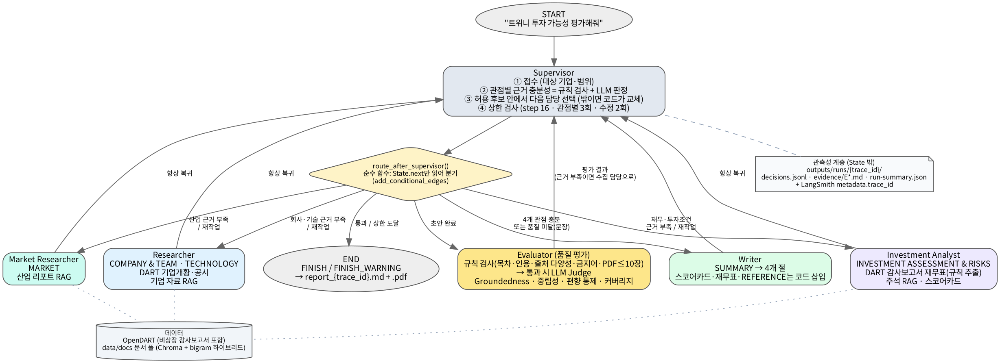

# Subject
본 프로젝트는 **Physical AI·로보틱스 비상장 스타트업**의 투자 가능성을
**COMPANY & TEAM · TECHNOLOGY · MARKET · INVESTMENT ASSESSMENT & RISKS** 4개 관점에서 평가하는 보고서를
**Supervisor 패턴** 기반 멀티 에이전트로 설계·개발한 프로젝트임.
지난 RAG 과제와 같은 주제·목차·평가 가중치를 유지하고, 순차·병렬 흐름 대신 Supervisor 패턴을 적용했다.

## Overview
- **Objective** : 로보틱스 스타트업 1곳을 복수 관점에서 근거 기반으로 평가하고, 품질 평가를 통과한 보고서만 내보낸다
- **Pattern** : Supervisor — 비상장 스타트업은 공개 자료가 적고 기업마다 확보되는 자료가 다르다.
  그래서 계획을 미리 나누는 Orchestrator보다, "근거가 충분한가"를 중앙에서 판단해 부족한 관점만 골라 재조사시키는 구조가 맞다고 판단했다.
- **동적 처리** : 실행 순서가 코드에 없다. supervisor가 매 턴 State(관점별 충분성·평가 결과·상한)를 보고 `next`를 정하고,
  `add_conditional_edges`가 그 값으로 분기한다. 같은 질문이라도 수집 결과에 따라 경로가 달라진다
  (예: `researcher → market_researcher → investment_analyst → market_researcher(산업 근거 재작업) → writer → evaluator → writer(수정) → evaluator → FINISH`).

## Target & Evaluation Frame
- **대상** : DART에 등록된 국내 Physical AI·로보틱스 비상장 스타트업 (데모: **트위니** — 자율주행 물류로봇, 2015년 설립, 2026년 프리IPO 단계)
- **선정 이유** : 비상장이지만 외부감사 대상이라 DART 감사보고서로 **실제 재무 숫자**를 확인할 수 있고, Exit(상장) 전 단계라 지난 과제의 대상 조건(비상장·Exit 미완료)과 맞는다.
- **평가 가중치 (지난 과제와 동일)** : 창업자 5 / 시장성 30 / 제품·기술력 25 / 경쟁 우위 20 / 실적 10 / 투자조건 10.
  근거가 없는 항목은 결측으로 남기고 분모에서 뺀다. 점수는 평가 보조 지표이며 투자 권유가 아니다.

## Features
- **PDF·공시 자료 기반 정보 추출** : `data/docs`의 산업 리포트·기업 자료(PDF·수집 메모)를 RAG로 검색, DART 감사보고서 원문(XML)의 감사의견·주석을 RAG로 검색
- **숫자는 Python이 처리** : 감사보고서 재무제표 표에서 핵심 계정(2개년)을 규칙으로 추출하고, 성장률·이익률·자본잠식·현금 소진 기간을 코드가 계산
- **근거 충분성 판정 (Supervisor)** : 규칙 검사(필수 근거 종류·내용·근거 ID 연결) → 통과한 관점만 LLM 판정
- **재작업 요청** : 부족한 관점만 골라 그 근거를 모으는 담당에게 사유와 함께 되돌림 (관점별 최대 3회)
- **확증 편향 방지 전략** : 절마다 서로 다른 근거 2개 이상, 보고서 전체 출처 3종 이상 규칙 / 회사 자체 주장은 "회사 측 주장"으로 구분 / 손실·자본잠식 등 불리한 지표 동시 서술 / 판정 표현 금지어
- **보고서 품질 평가** : 규칙 검사(목차·인용·출처 다양성·금지어·**PDF 10장 이하**) → 통과 시 LLM Judge(Groundedness·중립성·편향 통제·커버리지). 미달 시 문장 문제는 writer 수정, 근거 부족은 수집 담당 재조사로 Loop
- **숫자 변형 방지** : 스코어카드 표·재무 원본 표·REFERENCE는 모델이 아니라 코드가 보고서에 삽입. 본문 `[E#]` 인용만 REFERENCE에 남는다
- **제출용 PDF** : 표지·머리말·쪽번호가 있는 A4 PDF를 실행마다 자동 생성

## Tech Stack
- Framework : LangGraph (Supervisor + ReAct 서브그래프), LangChain Core
- LLM/Generator : OpenAI `gpt-5-mini` (`OPENAI_MODEL`)
- LLM/Judge : OpenAI `gpt-5-mini` (`OPENAI_JUDGE_MODEL`로 생성 모델과 분리 가능)
- Retrieval : ChromaDB (Persistent, cosine) + 한국어 bigram 키워드 재정렬 — Hit Rate@5 / MRR은 `python scripts/eval_retrieval.py`로 측정 (질문 10개, 결과 `outputs/retrieval_eval.json`)
- Embedding : OpenAI `text-embedding-3-small`
- Data : OpenDART API (기업개황·공시·감사보고서 원문), `data/docs` 문서 풀
- Report : markdown → PDF (PyMuPDF, 한글 글꼴 내장)
- Tracing : LangSmith (`metadata.trace_id`로 로컬 결정 로그와 연결)

## Agents
- **Supervisor** : 대상 기업·범위 접수, 관점별 근거 충분성 판정, 허용 후보 안에서 다음 담당 선택, 재작업·수정 요청, 종료 결정. 하위 에이전트끼리는 엣지가 없고 모든 통신은 supervisor를 거친다
- **Researcher** : DART 기업개황·공시, 기업 자료 RAG → COMPANY & TEAM, TECHNOLOGY
- **Market Researcher** : 산업 리포트 RAG → MARKET (시장 규모·성장률·경쟁·비즈니스 모델)
- **Investment Analyst** : DART 감사보고서 재무표·주석 → INVESTMENT ASSESSMENT & RISKS, 투자 평가 스코어카드
- **Writer** : 관점별 결과·근거·스코어카드만으로 보고서 작성
- **Evaluator** : 보고서 품질 평가 노드 (규칙 검사 + LLM Judge), 실패 원인에 따라 되돌릴 담당 지정

### Supervisor 필수 항목 구현 위치

| 과제 필수 항목 | 구현 |
|---|---|
| 하위 에이전트는 Supervisor하고만 통신 | `graph.py` — worker → supervisor 엣지만 존재, worker 간 엣지 없음 |
| State 기반 `add_conditional_edges` 분기, 순서 하드코딩 금지 | `supervisor.py`가 `next` 기록 → `graph.route_after_supervisor()`(순수 함수)가 분기 |
| 근거 충분성 평가 후에만 보고서 작성 (스텝 고정 금지) | `supervisor.py` 4단계 — 4관점 모두 충분하거나 재작업 한도 소진 시에만 `writer`가 허용 후보가 됨 |
| 근거 부족 시 해당 하위 에이전트 재작업 | `responsible_workers()` — 없는 근거의 수집 담당 / 내용이 부족하면 작성 담당에게 사유와 함께 재지시 (`is_rework` 로그) |

판단과 분기를 나눴다. LLM은 충분성 판정과 '허용된 후보 중' 다음 담당만 고르고, 허용 후보 계산·상한 검사는 코드가 한다.
LLM이 후보 밖을 고르면 코드가 기본 경로로 교체하고 그 사실을 결정 로그(`llm_override`)에 남긴다.

## State Schema
코드: [`finance_agent/state.py`](finance_agent/state.py)

```python
class FinanceState(MessagesState):
    # 작업 페이로드
    question, company: str
    perspectives: Annotated[dict[str, PerspectiveResult], merge_dict]   # 관점별 결과·근거 ID·충분성
    evidence: Annotated[list[EvidenceRef], operator.add]                # 근거 참조 (원문은 파일)
    scorecard: Scorecard | None                                         # 항목별 1~5점, 가중합은 코드
    report: str | None
    eval_result: EvalVerdict | None
    # 제어 메타데이터
    trace_id: str; next: str; instruction: str; target_perspectives: list[str]
    step_count: int; max_steps: int
    attempts: Annotated[dict[str, int], merge_dict]; revision_count: int
    node_status: Annotated[dict[str, str], merge_dict]; last_error: str | None; status: str
```

- **제어 vs 페이로드 분리** : 위 두 블록으로 분리. supervisor 라우팅은 제어 메타와 관점별 `sufficient` 플래그만 보고 결정한다
- **관측성 위치** : 결정 로그(노드·결정·사유·대상 관점·재작업 여부)는 State가 아니라 `outputs/runs/{trace_id}/decisions.jsonl`에 적재
- **지속성 비용** : 도구 원문(감사보고서 재무표, 문서 발췌 등)은 `evidence/E*.md` 파일로 저장하고 State에는 `EvidenceRef`만 둔다. 감사보고서 XML은 `.cache/audit/`에 캐시. `messages`는 사용자 질문과 최종 보고서만 담는다
- **상관** : `trace_id` 하나로 State ↔ decisions.jsonl ↔ evidence 파일 ↔ LangSmith run(`metadata.trace_id`, tag `trace:{id}`)을 연결
- **재개/복구** : `InMemorySaver` checkpointer + `node_status`·`last_error`·`attempts`. 하위 에이전트 예외는 그래프를 멈추지 않고 `error`로 기록되며 supervisor가 재시도 여부를 판단. 스코어카드 생성이 실패하면 writer가 한 번 더 시도
- **동시 처리** : 누적 필드는 reducer로 병합 — `evidence`는 이어붙이기, `perspectives`·`attempts`·`node_status`는 dict 병합 (같은 관점을 여러 담당이 채우면 내용·근거 ID를 합침). ReAct의 병렬 도구 호출로 Chroma 클라이언트가 동시에 만들어지지 않게 잠금
- **종료 보장** : `config.py` 상수로 코드에서 강제 — supervisor 판단 16회, 관점별 작업 3회(재작업 2회), 품질 미달 수정 2회, ReAct 도구 호출 8회, LangGraph `recursion_limit` 80. 상한 도달 시 `FINISH_WARNING`으로 경고를 붙여 종료

## Architecture


## Directory Structure
```
├── data/docs/             # 문서 풀 (industry/ 산업 리포트, companies/<회사명>/ 기업 자료)
├── finance_agent/
│   ├── graph.py           # Supervisor 그래프 연결 (add_conditional_edges)
│   ├── supervisor.py      # 접수·충분성 판정·라우팅·재작업·종료 결정
│   ├── state.py           # State Schema
│   ├── config.py          # 상한·관점·스코어카드 가중치 (코드로 강제하는 정책)
│   ├── observability.py   # trace_id, 결정 로그, 근거 파일
│   ├── runner.py          # 초기 State·실행 config·산출물 저장 (CLI·API 공용)
│   ├── pdf_export.py      # 제출용 PDF (표지·머리말·쪽번호)
│   ├── llm.py             # 모델 호출 창구
│   ├── agents/            # researcher·market_researcher·investment_analyst(workers.py), scorecard, writer, evaluator
│   ├── prompts/           # 에이전트별 프롬프트 템플릿
│   └── tools/             # OpenDART 클라이언트, 감사보고서 파서, 문서 풀 RAG, 도구 정의
├── scripts/eval_retrieval.py  # 검색 품질 측정 (Hit Rate@5, MRR)
├── tests/                 # 가짜 LLM으로 라우팅·재작업·평가 루프·종료·스코어카드·파서 검증
├── outputs/               # 실행 결과 (reports/, runs/{trace_id}/)
├── backend/ frontend/     # FastAPI SSE API, Next.js UI (선택)
├── docs/                  # 아키텍처 그림
├── main.py                # CLI 실행 스크립트
└── README.md
```

## Usage
```bash
python -m venv .venv && source .venv/bin/activate
pip install -r requirements.txt
cp .env.example .env        # OPENAI_API_KEY, OPENDART_API_KEY, LangSmith 키 입력

python main.py "트위니 투자 가능성 평가해줘"
python scripts/eval_retrieval.py      # (선택) 검색 품질 측정
```

실행이 끝나면 다음이 생성된다.

| 파일 | 내용 |
|---|---|
| `outputs/reports/report_{trace_id}.pdf` | 최종 보고서 (제출용 PDF, 표지·쪽번호, 최대 10장) |
| `outputs/reports/report_{trace_id}.md` | 최종 보고서 (마크다운) |
| `outputs/runs/{trace_id}/decisions.jsonl` | supervisor 라우팅·재작업·평가 결정과 사유 |
| `outputs/runs/{trace_id}/run-summary.json` | 라우팅 순서, 재작업 횟수, 수정 횟수, 최종 상태 |
| `outputs/runs/{trace_id}/evidence/E*.md` | 근거 원문 |

다른 기업을 평가하려면 `data/docs/companies/<DART 회사명>/`에 그 기업의 자료(PDF 또는 수집 메모)를 넣는다. 자료가 없으면 해당 관점은 결측·한계로 표시된다.

테스트 (API 키 불필요):
```bash
pytest -q
```

웹 UI (선택): `uvicorn backend.app:app --port 8000` 후 `cd frontend && npm install && npm run dev`

## Contributors
- 심혁 : Supervisor 설계(충분성 판정·재작업·종료 가드), State Schema, 품질 평가 노드, 투자 평가 스코어카드·재무지표 설계, DART 감사보고서 파서, 문서 풀 RAG, 관측성 계층, 제출용 PDF, 테스트, README

> 본 프로젝트의 보고서는 공개 자료 기반의 평가 참고 자료이며 투자 권유가 아닙니다.
